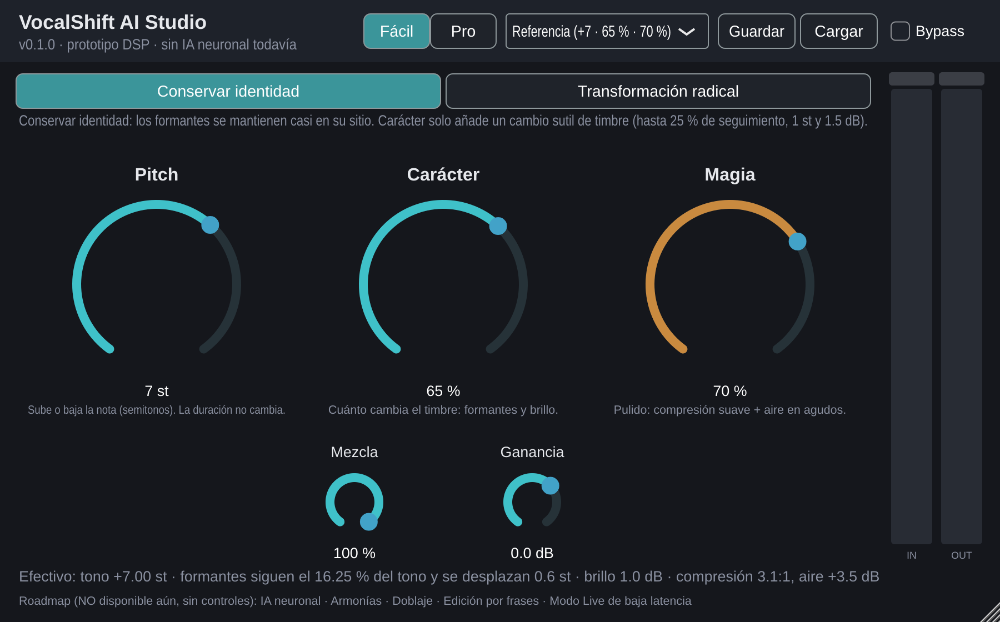

# VocalShift AI Studio

Plugin VST3 de transformación vocal (Windows 11 x64 / FL Studio como objetivo principal).

**Estado: prototipo V0 + V1 (DSP).** Procesa audio real y está probado con pruebas automatizadas y pluginval,
pero **todavía no ha sido validado por una persona dentro de FL Studio ni con voces humanas**. No hay IA neuronal.

## Qué hace hoy (implementado y probado)

| Función | Detalle |
|---|---|
| Macroperillas | **Pitch** (±24 st + fino ±100 ct), **Carácter** (timbre: formantes + brillo) y **Magia** (compresión + aire), todas conectadas a DSP real. Referencia: +7 st / 65 % / 70 % ([docs/MACROS.md](docs/MACROS.md)) |
| Modos | **Conservar identidad** (formantes casi fijos) y **Transformación radical** (formantes siguen y se desplazan, hasta 6 st). No es conversión de identidad por IA |
| Nivel automático | Iguala el RMS procesado al original (compensa la pérdida de nivel del motor) |
| Mezcla | Dry/wet alineado en latencia, ganancia de salida, protección de picos (soft clip, techo 0 dBFS) |
| Bypass | Sin clics (fundido 20 ms), mantiene la latencia, salida idéntica a la entrada retardada |
| Estado | Proyecto restaurable, versionado (`stateVersion` 2, con migración desde v1), 12 parámetros automatizables |
| Presets | 9 presets de fábrica (incl. Referencia y Neutro) + presets de usuario (`.vspreset`, XML versionado) |
| Interfaz | Modo Fácil y Pro sobre el mismo estado, redimensionable, medidores IN/OUT con indicador de clip |
| Latencia | 150 ms constantes, reportada al host (modo calidad; no hay modo de baja latencia) |

## Compilar

Requisitos: CMake ≥ 3.24, compilador C++17 (MSVC 2022 en Windows). Las dependencias se descargan fijadas por versión.

```bash
cmake -S . -B build -DCMAKE_BUILD_TYPE=Release
cmake --build build --config Release
ctest --test-dir build -C Release --output-on-failure
```

El VST3 queda en `build/VocalShift_artefacts/Release/VST3/VocalShift AI Studio.vst3`.

En cada push, GitHub Actions compila en Windows, ejecuta las pruebas y pluginval, y publica el VST3 como artefacto
descargable (pestaña *Actions* → ejecución → *Artifacts*).



## Documentación

- [docs/FL_STUDIO_GUIDE.md](docs/FL_STUDIO_GUIDE.md) — instalar y probar en FL Studio
- [docs/EXPERIMENT_01_VOZ_REAL.md](docs/EXPERIMENT_01_VOZ_REAL.md) — siguiente experimento con voz humana
- [docs/MACROS.md](docs/MACROS.md) — qué hace realmente cada macroperilla
- [docs/ARCHITECTURE.md](docs/ARCHITECTURE.md) — módulos y reglas de tiempo real
- [docs/TECH_EVALUATION.md](docs/TECH_EVALUATION.md) — dependencias, licencias y alternativas
- [docs/QUALITY.md](docs/QUALITY.md) — pruebas, mediciones, limitaciones y protocolo de escucha
- [docs/ROADMAP.md](docs/ROADMAP.md) — siguientes bloques
- [THIRD_PARTY_NOTICES.md](THIRD_PARTY_NOTICES.md)

## Licencia

Pendiente de decisión del propietario (ver `docs/TECH_EVALUATION.md`, sección JUCE). Hasta entonces, todos los
derechos reservados.
